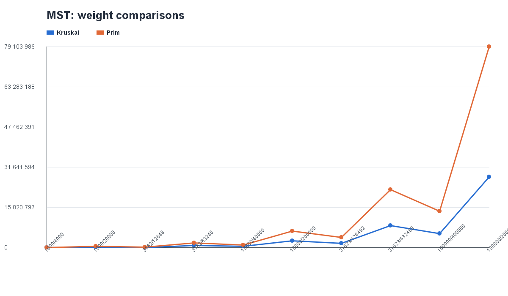
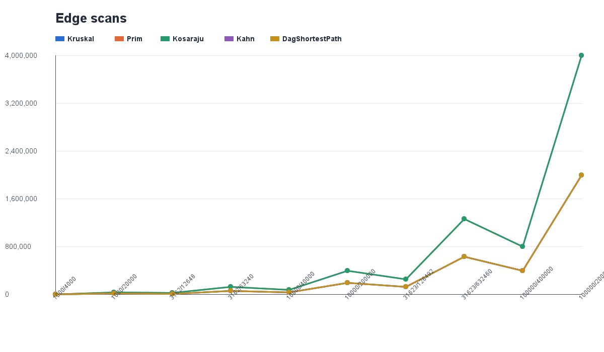
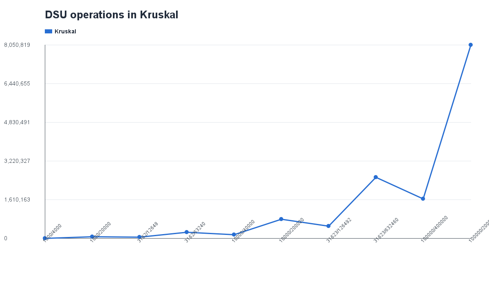

# Assignment 3 — Graph Algorithms Report

## 1. Introduction

In this assignment, I worked with different graph algorithms using Java. I implemented DSU, Kruskal, Prim, Kosaraju, Kahn, and shortest paths in a DAG.

The main goal was to understand how these algorithms work, check if they give correct answers, and compare how many operations they perform on different graphs.

I also used JUnit tests and created a benchmark with graphs of different sizes.

## 2. How I Implemented the Algorithms

### DSU

DSU is used to keep track of groups of connected vertices.

I used union by size and path compression. Union by size connects the smaller group to the bigger one. Path compression makes the next `find` operations faster.

DSU is useful in Kruskal's algorithm because it helps check whether two vertices are already connected.

The time complexity of one operation is almost constant, or `O(α(n))`.

### Kruskal

Kruskal finds a minimum spanning tree.

First, it sorts all edges by weight. Then it checks them one by one and adds an edge if it does not create a cycle.

I used DSU to check this.

The time complexity is `O(E log E)` because sorting takes the most work.

### Prim

Prim also finds a minimum spanning tree, but it works differently.

It starts from one vertex and keeps adding the cheapest edge that connects to a new vertex.

I used a priority queue for this algorithm.

The time complexity is `O(E log V)`.

Kruskal and Prim should give the same total MST weight. I checked this in my tests and benchmark.

### Kosaraju

Kosaraju finds strongly connected components in a directed graph.

It uses two DFS passes. The first pass finds the finishing order of vertices. The second pass uses the reversed graph to find the components.

I used an explicit stack instead of recursion because the assignment includes graphs with up to 100,000 vertices.

The time complexity is `O(V + E)`.

### Kahn

Kahn's algorithm is used for topological sorting.

It starts with vertices that have no incoming edges. After processing a vertex, it updates the incoming edge counts of its neighbours.

If all vertices are processed, the graph does not have a directed cycle.

The time complexity is `O(V + E)`.

### Shortest Paths in a DAG

For this algorithm, I first get the topological order of the graph.

Then I go through the vertices in that order and update the shortest distances.

I used distance zero for all source vertices.

This algorithm works with negative weights too, because a DAG has no directed cycles.

The time complexity is `O(V + E)`.

## 3. Testing

I used JUnit to test my algorithms on small graphs.

I checked connected graphs, disconnected graphs, cycles, and DAGs.

All 8 tests passed.

I also compared Kruskal and Prim. They gave the same MST weight for all generated graphs.

After fixing the graph generator, my benchmark results matched the reference table from the assignment.

## 4. Benchmark

For the benchmark, I used five graph sizes:

- 1,000 vertices
- 3,162 vertices
- 10,000 vertices
- 31,623 vertices
- 100,000 vertices

For each size, I used two numbers of edges: `4n` and `20n`.

I generated three types of graphs: undirected graphs for MST, directed graphs for Kosaraju, and DAGs for Kahn and shortest paths.

I used `Random(42)` so the generated graphs would be the same every time.

The results were saved in `results/results.csv`. There are 50 rows because I tested five algorithms on ten graph configurations.

I recorded execution time and different operation counters, including DSU operations, edge scans, comparisons, and maximum stack depth.

I focused more on operation counts than execution time because time can change depending on the computer and JVM.

## 5. Results

### Kruskal and Prim

Kruskal and Prim returned the same MST weight for every graph.

For example:

| Vertices | Edges | MST Weight |
|---|---|---|
| 1,000 | 4,000 | 147970 |
| 1,000 | 20,000 | 30363 |
| 10,000 | 40,000 | 1486139 |
| 10,000 | 200,000 | 309550 |
| 100,000 | 400,000 | 15012094 |
| 100,000 | 2,000,000 | 3056681 |

I noticed that graphs with more edges usually had smaller MST weights. This makes sense because the algorithm has more edges to choose from.

I also compared the number of weight comparisons in Kruskal and Prim.

On the largest dense graph, Prim made more comparisons than Kruskal.

### Edge Scans

I counted how many edges each algorithm checked.

In my implementation, Kruskal scans `m` edges, while Prim scans `2m` adjacency entries because the graph is undirected.

Kosaraju also scans `2m` edges because it uses two DFS passes.

Kahn and DAG shortest paths scan `m` edges.

The graph shows that the number of edge scans increases when the number of edges increases.

### DSU Operations

I also counted DSU operations in Kruskal.

For the largest graph with 100,000 vertices and 2,000,000 edges, Kruskal performed 8,050,819 DSU operations.

The number of operations grows with the graph size, but union by size and path compression help keep DSU efficient.

### Kosaraju

Kosaraju found different numbers of strongly connected components depending on the graph density.

For example, the graph with 1,000 vertices and 4,000 edges had 27 components.

When the number of edges increased to 20,000, the graph had only one strongly connected component.

This shows that adding more directed edges can make more vertices connected in both directions.

### Kahn and DAG Shortest Paths

Kahn processed all vertices in the generated DAGs. This means the graphs had valid topological orders.

The shortest-path results also matched the reference values.

Both algorithms were efficient because they only needed to process vertices and edges in a linear way.

## 6. Which Algorithm I Would Choose

I would use Kruskal when I have a list of weighted edges and need a minimum spanning tree.

I would use Prim when I have an adjacency list and want to build the MST starting from a vertex.

For finding strongly connected components in a directed graph, I would choose Kosaraju.

For tasks with dependencies, like deciding which task should be done first, I would use Kahn.

If the graph is a DAG and I need shortest paths, I would use the DAG shortest-path algorithm because it is fast and also works with negative weights.

## 7. Conclusion

In this assignment, I learned how several graph algorithms work and how to implement them in Java.

The most useful part for me was comparing Kruskal and Prim, because they solve the same problem in different ways but give the same MST weight.

I also learned why iterative DFS is useful for large graphs and how topological sorting helps with shortest paths in a DAG.

All my JUnit tests passed, and the benchmark results matched the reference values.

Overall, this assignment helped me understand not only how to write graph algorithms, but also how to check their correctness and compare their performance.